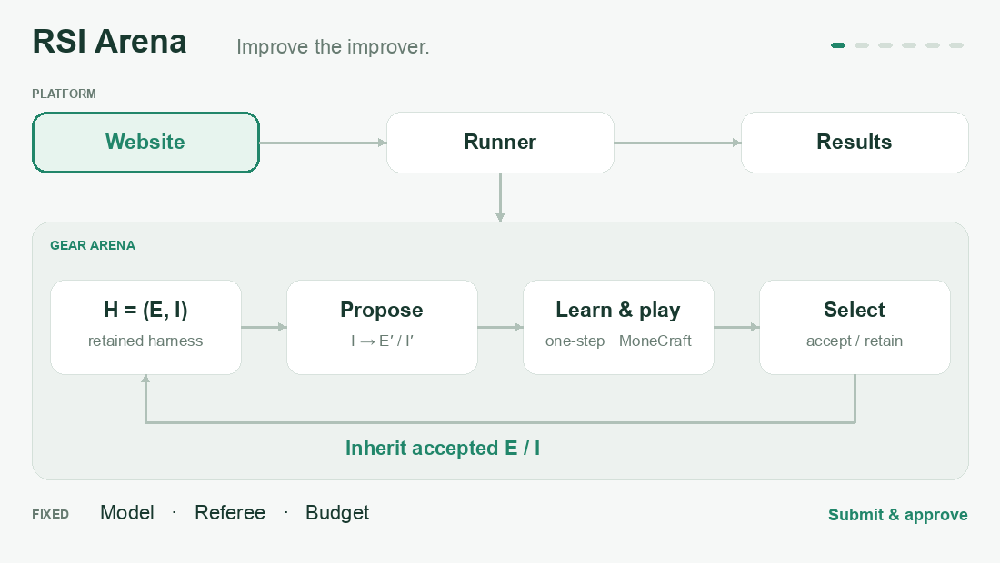

# Gear × MoneCraft RSI Arena

以对战游戏为环境，评测 Agent 的递归自我改进。总目标是交付可复现、公平、预算受控的实验系统及公开网站；允许负结果，不以获得正收益作为完成条件。

[在线演示](https://rsi-arena-lab.chengrenmin76.chatgpt.site) · [复现指南](rsi-arena/docs/reproduction.zh-CN.md) · [协议](gear/docs/arena-v3.zh-CN.md)

**研究首版。** 线上受控流程已通过验收；历史真实模型试验来自 v2，新增 v3 真实模型线上验收暂缓。当前证据不支持宣称递归 RSI 带来了性能收益。

## 架构与递归闭环



[查看静态大图](docs/assets/rsi-architecture.png) · [架构与模块边界](rsi-arena/docs/architecture.zh-CN.md)

动图展示协议流程，不是实测收益或对局录像。`H=(E,I)`：E 负责生成、训练后修订策略；I 负责改进指令。**B 组固定 I，C 组允许 E/I 一起变化**。一步后续评测只执行临时 E，临时 I 被丢弃；只有完整候选 H 被接受后，其中的 I 才在下一代真正提出新候选。拒绝时保留父代。当前网站首版运行一代搜索，再冻结 B/C 做独立审计；多代继承已有受控测试。

Gear 提供基础优化框架；本项目扩展 Arena 协议、预算账本和游戏适配，并自建网站与独立执行器。模型、裁判、评测规则和额度不参与进化，首版不训练模型权重。

## 无付费复现

```sh
git clone https://github.com/labixiaoQ/RSI-Arena.git
cd RSI-Arena
python3 aaarena/scripts/install_assets.py --games monecraft
python3 aaarena/scripts/install_assets.py --games monecraft --verify-only
```

接着按[复现指南](rsi-arena/docs/reproduction.zh-CN.md)安装依赖、构建 Gear、运行测试和打开本地网站。需要 Node.js 24+（或 22.19+）、npm 和 Python 3.10+；受控验证不需要模型密钥或 Docker。此仓库已包含 Gear 扩展源码，无需再次应用补丁。

## 项目入口

| 目录 / 文档 | 内容 |
| --- | --- |
| [gear/](gear/) | 在固定 Gear 基线上扩展的 RSI 协议、五维预算账本、MoneCraft 适配与测试 |
| [aaarena/](aaarena/) | 上游游戏 SDK、裁判、对手及来源信息 |
| [rsi-arena/](rsi-arena/) | 网站、D1/R2 后端、独立 runner 和运行说明 |
| [总体验收清单](ACCEPTANCE.zh-CN.md) | 当前证据、未完成项与完成边界 |
| [RSI v3 协议](gear/docs/arena-v3.zh-CN.md) | I 继承、一步后续评测、失败结算和研究口径 |
| [运行与恢复](rsi-arena/docs/runner.zh-CN.md) | 执行器配置、任务批准、取消与未知消耗处理 |
| [源码复现](rsi-arena/docs/reproduction.zh-CN.md) | 完整仓库安装、测试、本地网站与可选升级包 |

## 当前证据

- 受控验证覆盖三代 I 继承、拒绝后保留原 I、一步后续评测、反馈学习、完整代预算和零调用恢复。
- [真实 B/C 试验](gear/docs/validation/arena-comparison-v2-2026-11-11.md) 实际 23 次模型请求、79,462 token、42 局。B/C 最终保留同一个 H；均分差 **不能归因于递归 RSI**。
- 网站公开上述 42 局的完整回放、谱系、得分、成本和证据边界。历史 v2 结果不改称 v3 成果。
- 网站本地和线上受控完整流程通过，最终 39 项平台/runner 测试通过；远程 WSL 已完成相同固定镜像的一局 1000 回合运行验收。上线状态与限制见 [WSL 部署记录](rsi-arena/docs/validation/wsl-deployment-2026-11-11.md)。

模型真实试验、受控模拟、实际游戏的工程检查分别记录。此前真实模型试验的账本继续保留，不因目录、版本、网站或新任务而清零；新增付费试验必须有新的具体授权。

本轮公开仓库复现验证：Gear 49 项、平台/runner 39 项测试通过，并跑通本地零费用端到端流程；详见[审查记录](docs/review-2026-11-11.md)。

## 来源与复用

基于 [Gear](https://github.com/rsi-gear/gear) 与 [AAArena / MoneCraft](https://github.com/THU-CST-SAST/AAArena) 的独立研究项目。保留上游 MIT 许可证，见[第三方声明](THIRD_PARTY_NOTICES.md)。历史回放与公开摘要已包含；原始模型请求、私有账本和运行密钥未公开。
