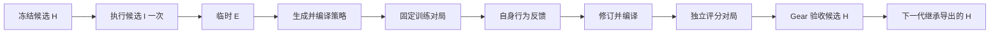

# Gear × MoneCraft：最小 RSI 闭环

这是开发验证实现：固定模型，进化执行器 E 和改进器 I 的指令。游戏策略 P 是每次评测重新生成的 C++ 文件。网站、模型训练、任意源码级改进器、开放搜索树、正式隐藏测试均不在首版内。

## 闭环与继承

每代启动时冻结 `H_t = (E_t, I_t)`。固定调度器依次评测锚点、由 `I_t` 提案一个候选、评测候选、交给 Gear 验收。每个学习评测执行：

1. 从候选复制 H，仅调用一次候选 I，得到临时 `(E⁺, I⁺)`。
2. 协议 v2 中，E⁺ 从固定 P0、SDK 和经行为校验的游戏契约出发，执行生成、编译、训练对局、反馈修订。最多三次策略调用，包含最多一次编译/格式修复；失败保留最后一个可编译策略。历史协议 v1 保留单次生成路径。
3. 原版 MoneCraft 裁判让 P⁺ 与固定对手交换双方位置对战，胜/平/负为 1/0.5/0，取平均值。
4. I⁺ 只记录，不继续调用，也不跨代继承；临时 E⁺ 与 P⁺ 同样不继承。
5. Gear 根据开发集收益与开发验收集决定 champion。下一代实际执行的是导出的 champion 内的 I，而不是初始 I，也不是临时 I⁺。拒绝时保持原 champion。

因此修改 I 可以在候选 E 不变时，通过下一步 E⁺ 和 P⁺ 影响分数。首版测的是“一次后续学习效果”，不据此声称已证明长期递归收益。`fixed-improver` 模式禁止提案修改 I，作为对照；历史 `run.mjs` 保留 v1 路径；新增 `compare.mjs` 固定执行 B/C 对照。

## 复用与改造边界

| 部分 | 实现责任 |
| --- | --- |
| run admission、sealed target、journal、operation receipts、最终验收、champion 导出 | 直接复用 Gear |
| `arena` harness 类型注册 | Gear 原有类型/配置检查中做小范围扩展 |
| 每代一个 Gear project、线性调度、一层后续评测、跨代导出继承 | 新增 `src/adapters/arena/`，不改 Gear 核心状态机 |
| 实验级预算与外部调用恢复 | 新增 SQLite 账本；覆盖所有代和内部调用 |
| MoneCraft 游戏、SDK、裁判、AI9 relay | AAArena 固定版本，裁判源码不改 |
| Mac 开发运行容器、编译与选手隔离、结果桥接 | 新增开发适配器；不是 AAArena 参考运行配置 |
| 模型 | 现有 `DEEPSEEK_API_KEY`，固定模型名和参数；密钥不写入产物或容器 |

上游版本：Gear `11bad082e1163d12caf2f955125d596f40b395f1`；AAArena `fd52d2337b6711f0f3a239216f48720c125750be`。MoneCraft 归档 SHA-256：`69fffd4d77f7da743e22a4251ef9920cd0f082ef110647a0db815a44657a287a`。

## 接口与产物

公共入口为 `rsi-gear/arena` 的 `runArenaExperiment`、`comparisonPlan` 和 `runArenaComparison`。输入包含初始 H、固定协议、模型与对局后端、代数、总预算和截止时间。`ModelBackend` 提供调用前的额度上界和调用后的实际 usage；`MatchBackend` 返回可验证对局回执，基础设施错误必须抛错，不能伪装为零分。协议 v2 要求 `MatchBackend.compile` 提供独立编译回执；不运行裁判，因此不计为对局，单次编译仍有 CPU/时间限制。每个 episode 最多四次独立编译（P0 一次、策略最多三次），每场对局内部还会编译双方策略。

- H 仅允许 `executor.json` 和 `improver.json`，各为 `{version:1,instruction:string}`，拒绝额外文件、符号链接和额外字段。
- `experiment.json` 固定协议、初始 H、实现身份和截止时间；参数改变须使用新目录；新目录不代表新的模型调用授权。
- `budget.sqlite` 保存每次调用的身份、预留、实耗和结果。
- `epochs/NNN/start.json`、`epoch.json` 保存父代、实际执行 I、保留 I、导出位置和验收状态。
- 每代 Gear 状态目录内的 `arena-operations/` 保存意图、回执和学习轨迹；轨迹包括实际执行 I/E 的哈希、丢弃的临时 I、P⁺、每局结果和回放路径。
- `matches/` 保存实际编译日志、选手日志和原版 `result.txt`。
- `report.json` 汇总所有代、总预算、模型/游戏后端类别，并明确标注正式隐藏测试未实现。

## 预算与恢复语义

额度在外部动作前事务性预留。统计维度为 agent 调用数、模型请求数、token、学习 episode 数、对局数，以及整个实验的持久化截止时间。提案、后续改进、策略生成、锚点、候选和验收对局全部计费，不按代重置。

token 预留使用输入 UTF-8 字节数加 framing 余量和最大输出额度，回执到达后按服务端 usage 结算。该保守上界适用于当前 DeepSeek 文本接口；它不是费用报价。美元费用和 provider 内部隐藏计算不提供硬上限。

已确认回执可重复读取，不重复调用；请求 ID 内容冲突会失败。已提交但没有可确认结果时保留全部预留，并进入 `needs_recovery`，不自动再次发起。中断后需要原目录、原配置、原实现重新运行；变更预算或代码不会悄悄重置旧实验。首版没有自动核销不明请求的管理工具，需保留证据人工处理。

真实试验发现首局运行环境错误后，增加了一个有限的修复续跑入口 `--continue-from OLD_DIRECTORY`：仅允许尚未形成任何对局评分、已有两个确认模型响应的起始阶段。操作者须先确认旧对局已终止。它保留旧实验，只允许绑定一个新的后继目录，从原总额度中扣除旧实耗和不明预留，按相同输入顺序一次性复用两个确认响应；后续同样的提示仍重新请求模型。新的镜像、模型包装器和实现身份独立记录。结果合计见 `authorization-budget.json`，不能将新目录的局部消耗当成总消耗。该入口不支持一般的中途迁移或不明模型请求重试。

单局另设 CPU、内存、进程数、文件和时间限制。编译器与双方选手分别放入独立文件系统/网络/PID 环境；选手看不到裁判、请求文件、对手源码或模型凭证。整个容器无外网。隔离建立失败时停止验证。该开发路径使用上游 unsupervised loader 以适配 Mac 的 x86 模拟，不等同于参考平台的 ptrace/cgroup 配置。

选手链接公开 SDK 的 `sdk.cc`，包含 `in_range`、`legal_pos`、`get_terrain` 和 Position 运算符。适配层还提供头文件声明、但原加载器没有导出的 `PLAYER_NUM=2`、`MINE_NUM=6`；只适用于固定的双人 fight 模式，并核对裁判输出的初始玩家/矿点数量。链接时拒绝未定义符号，避免源码编译成功后在装载阶段失败并产生不完整回放。SDK 回归检查覆盖全部这些导出以及真实模型已生成的五个策略。历史实验恢复须指定其记录中的镜像 ID，不能依赖后来更新过的 `dev` 标签。

## 本地运行

要求 Node 22.19+ 或 24+、Gear Python 环境，以及支持 Linux amd64 和非特权用户命名空间的 Docker。Apple Silicon 开发机可使用独立 Colima profile，参考榜单应转到 AAArena 指定的原生 Linux x86_64 环境。

工作区目录布局为相邻 `gear/` 与 `aaarena/`；先按 AAArena 文档准备并校验 `games/monecraft`。从父目录构建：

Mac 开发环境使用独立 profile，可先运行 `colima start --profile gear-arena --arch aarch64 --vm-type vz --vz-rosetta --cpu 2 --memory 4 --disk 15`。以下 Docker 命令均显式指定该 profile 的 context，不依赖全局默认 context。结束后可用 `colima stop --profile gear-arena` 释放虚拟机资源。

```sh
docker --context colima-gear-arena build --platform linux/amd64 \
  -f gear/examples/arena/runtime/Dockerfile -t gear-arena-monecraft:base .
docker --context colima-gear-arena build --platform linux/amd64 \
  -f gear/examples/arena/runtime/Dockerfile.rosetta -t gear-arena-monecraft:dev .
```

第二步仅用于 Rosetta：使用固定 SHA-256 的 Ubuntu Bubblewrap 0.9 兼容层，避开未实现的 `open_tree`；原生 Linux 可直接将 base 标记为 dev。Ubuntu 24+ 的独立开发虚拟机还需要加载 `examples/arena/runtime/gear-arena-bwrap.apparmor` 专用配置：将文件复制到虚拟机 `/etc/apparmor.d/gear-arena-bwrap` 后运行 `sudo apparmor_parser -r /etc/apparmor.d/gear-arena-bwrap`。CLI 默认使用这个命名配置，其他不需要该配置的 Docker 环境可指定 `--apparmor unconfined --context default`。这不修改全局 userns 开关。

开发容器允许内部创建命名空间和新 `/proc`，因此外层设置 `seccomp=unconfined` 和 `systempaths=unconfined`；选手仍受内部独立文件系统/网络/PID 隔离以及容器资源限制。首版不是面向敌意公开提交的生产安全边界，公开服务须切换到参考平台并专门审计。

从 Gear 目录安装、构建并运行：

```sh
npm ci
python3 -m venv .venv
.venv/bin/pip install -e ./python
npm run build
node examples/arena/preflight.mjs --output arena-runs/preflight
GEAR_PYTHON="$PWD/.venv/bin/python" node examples/arena/run.mjs \
  --fixture --game-root ../aaarena/games/monecraft \
  --output arena-runs/fixture --epochs 3
GEAR_PYTHON="$PWD/.venv/bin/python" node examples/arena/run.mjs \
  --game-root ../aaarena/games/monecraft --output arena-runs/deepseek \
  --model deepseek-flash --epochs 2 --agent-calls 20 --tokens 150000 --matches 40
```

`--fixture` 使用显式受控改进器，但仍调用真实游戏；不代表模型自进化。单元测试的游戏后端也是受控数据，会明确标记 fixture。真实模型实验没有保证晋升，分数不涨或 I 不变也是有效结果。

CLI 默认只用两张开发 seed（7 与 23）、两个固定对手，是连通性检查，不是独立任务族泛化实验。对战模式源码固定 1000 回合并忽略 `-rd`，适配器明确拒绝其他回合设置，保留原裁判。relay 仅加入 TCP_NODELAY 以消除本机小包延迟。结构上支持任务族分区，但这些小样本不支持统计结论。这是保留的历史 v1 路径。当前 v2 实现及对照入口见下文；两者不能混作同一个实验。

## 验收点

1. 三代受控实验中实际执行 I 的序列随已接受 champion 改变，拒绝代不改变 I。
2. 候选只改变 I 时，一步后续评测确实执行不同 I；临时 I⁺ 不被再次调用或继承。
3. 真实裁判生成回放和结果；基础设施失败与策略失败分开处理。
4. 各类预算在动作之前拦截，跨代共享；恢复不重复已完成调用，不明调用不会免费重试。
5. 开发验收集反馈不进入提案的反馈或记忆。
6. 真实 DeepSeek 请求与 usage 落盘，并与受控验证分开报告。


## v2：反馈学习与 B/C 对照

`monecraft-contract.txt` 描述固定 SDK 与裁判的实际行为。`runtime/contract-probe.cpp` 直接调用原裁判函数，校验四方向、障碍、闪现距离/CD、双方占矿、保护、观察者、视野和胜负。正式游戏仍使用原版裁判，不使用行为检查中的构造场景。



临时 I 不执行；训练修订全部由临时 E 完成。E 最多调用三次；修复槽只出现一次。训练与评分用不同 seed，评分后不再修订本次策略。自身反馈仅包含移动回合数、位置数、最长静止段、首次占矿回合、最终金币/矿数；完整回放、隐藏地图、对手源码不进入模型。开发反馈带候选 ID 与 H 摘要；开发验收及最终评测反馈不进入后续提案。

B 固定 I0、允许 E 进化；C 允许 E/I 进化。两组使用相同模型、P0、SDK、规则、对手、训练/开发划分、每代调度和预算上界。执行次序固定 B 后 C，属于小型配对试验；模型服务随时间漂移并未通过随机化消除。两组全部完成并冻结 H 后，分别在新 seed 上从 P0 重新学习和评测。最终评测不带开发记忆；使用同一固定训练集和对手池，检验的是新地图 seed 上的表现，不代表跨游戏、跨对手或正式隐藏榜单泛化。

每代开始前检查完整上界：锚点与候选的全部开发/验收 episode，加一次提案。默认两个开发任务时，上界为 17 次模型请求、4 个 episode、24 局（每 episode 2 局训练 + 4 局评分）。每次调用最多预留 32,768 token；超过上界的输入在请求发出前失败。恢复按本代已计账额度扣减，完整代额度不重复预留。每代不足时停止，不启动半代；外部故障仍保留不明预留。

默认一代 B/C，加两组各两个最终评测 seed，新增试验上界为 **50 次模型请求、1,638,400 token、12 个 episode、72 局**。token 是保守资源上界，不是预计账单。B/C 的额度互不借用；实际消耗允许因提前拒绝或未使用修复槽而不同，报告同时给出每组和总消耗。

仅生成计划，不读凭证、不调用模型或游戏：

```sh
node examples/arena/compare.mjs --game-root ../aaarena/games/monecraft \
  --output arena-runs/comparison-v2-pilot
```

取得该新增额度的明确授权后，在同一目录加 `--run` 执行。旧试验上限不会自动覆盖这份新计划。历史消耗不能清零。

本地受控学习验证（真实裁判，零模型请求，最多 6 局）：

```sh
node examples/arena/validate-learning.mjs --game-root ../aaarena/games/monecraft \
  --output arena-runs/learning-v2-new --image gear-arena-monecraft:feedback-v2
```

`Dockerfile.feedback` 是本机已有 SDK-complete 镜像的离线升级入口；使用前须确认基础镜像 ID 为 `sha256:40be09bd6785432928745308521c32d9cd57f4d7afb6c0df40f9cccf86c08e6f`。其他环境从完整 `Dockerfile` 和需要时的 Rosetta 兼容层构建，勿依赖本机标签存在。

对照目录包含 `plan.json`、`comparison.json`、`frozen.json`、B/C 各自的 search/audit 账本、逐 seed 评测和总报告。中途失败也汇总已有实耗与不明预留；不输出不完整的 C−B 结论。`paired_C_minus_B` 是两个最终均分之差，小样本不计算或声称显著性。

已确认但不满足 harness 契约的提案（超长、非 JSON、固定 I 组修改 I）现在记录为失败，停止本代并由 Gear 导出原父代；不自动重提、不放宽长度、不对无效候选评分。网络/运行错误和不明消耗仍按恢复故障处理。

2026-11-11 的真实试验触发了首版缺少的超长提案收尾分支。完整修订、严格回执重放与后续评测见 [真实 v2 对照报告](validation/arena-comparison-v2-2026-11-11.md)。该历史试验使用专门的 `finish-invalid-proposal.mjs` 收尾，原失败记录保持不变；不能用更新后的实现直接覆盖原实验身份。两组最终 H 相同，实际分差不作为 RSI 收益。
